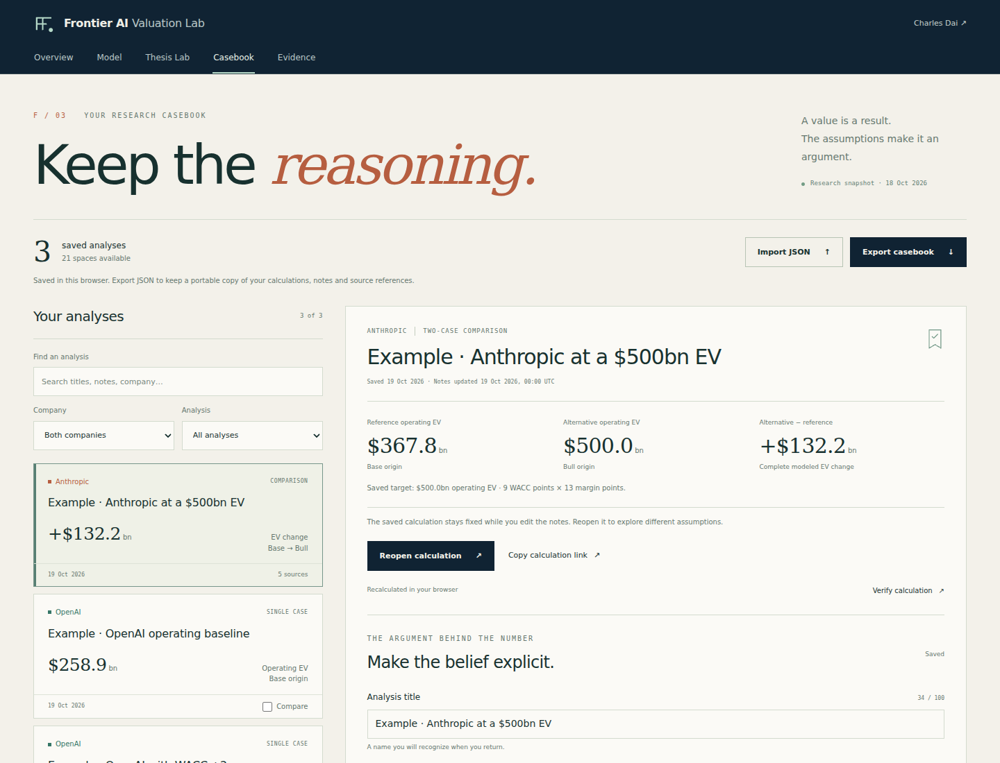
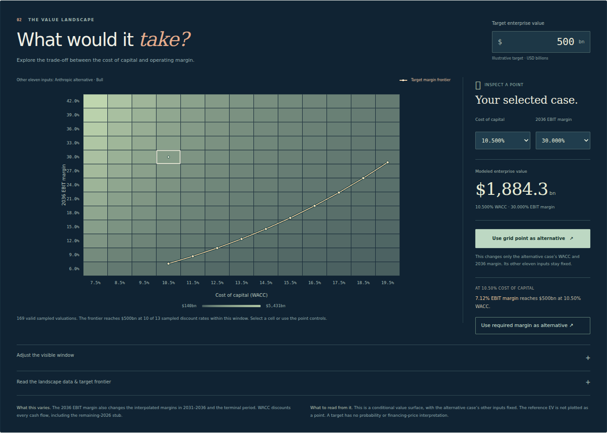

# Frontier AI Valuation Lab

**Follow the value. Keep the reasoning.**

[](https://github.com/ult666666/frontier-ai-valuation-lab/actions/workflows/ci.yml)

A full stack fintech research workspace by **Charles Dai**, Carnegie Mellon University. Compare Anthropic and OpenAI, test an operating thesis, explain the valuation change, and keep the exact analysis with its rationale and dated evidence. The **Research Casebook** brings the model, Thesis Lab and source context into one continuous workflow.

A deterministic JSON API, independently calculated Python reference, editable Excel model and source register make the arithmetic inspectable. Research and implementation were developed with AI assistance; the calculations can be reproduced from this repository.

**[Open the workspace](https://frontier-ai-valuation-lab.vercel.app/)** · **[Thesis Lab](https://frontier-ai-valuation-lab.vercel.app/thesis.html)** · **[Research Casebook](https://frontier-ai-valuation-lab.vercel.app/casebook.html)** · **[Evidence](https://frontier-ai-valuation-lab.vercel.app/index.html#sources)** · **[Portfolio](https://ult666666.github.io/)**

[Worked research brief](https://frontier-ai-valuation-lab.vercel.app/downloads/Frontier_AI_Research_Brief.pdf) · [Importable example casebook](https://frontier-ai-valuation-lab.vercel.app/downloads/Frontier_AI_Research_Casebook.json) · [Excel model](https://frontier-ai-valuation-lab.vercel.app/downloads/Frontier_AI_Valuation_Model.xlsx) · [Financial review](https://frontier-ai-valuation-lab.vercel.app/downloads/Frontier_AI_Valuation_Review.pdf) · [3.3 release](https://github.com/ult666666/frontier-ai-valuation-lab/releases/tag/v3.3.0) · [Verification](docs/VERIFICATION.md)



## Try the complete research journey

1. **Compare.** In the Overview, follow revenue, cash flow and value after 2036. Apply a common stress to both companies, then choose **Explain this change** to open the exact baseline and stressed case in Thesis Lab.
2. **Explain.** Read the signed allocation of the EV change across six assumption groups. Every attribution uses all **64 group combinations**, equivalent to averaging **720 orders of change**. Inspect the two complete sets of assumptions and their evidence.
3. **Test a requirement.** Set a target EV and select a cost of capital. **Use required margin as alternative** applies the full-precision solved margin. **Use grid point as alternative** applies the sampled point you selected. Both actions retain the other eleven assumptions.
4. **Inspect the forecast.** Open either case in the Model, edit its forecast or hypothetical equity bridge, and **Return to this comparison**. The untouched case, separate bridges, exact axes and target travel with the analysis.
5. **Keep the reasoning.** Choose **Save to Casebook**. Record why the case matters, what must hold, and what would change your mind. Attach relevant sources, verify the captured calculation through the API, and export a complete JSON casebook or a script-free research brief.

The downloadable example casebook contains three **clearly labeled illustrative analyses**, including a $500B target requirement. Import it from the Casebook to inspect a worked argument. It does not create sample entries in your browser automatically.

Application **3.3.0** adds the Research Casebook, contextual evidence and complete workflow handoffs. Financial engine **3.0.0**, the six published presets, the reviewed Excel/PDF and the **18 October 2026** research cutoff remain the quantitative baseline. This is a dated research model. Browser storage is local to the current origin and profile; JSON export provides portability across devices.

See the [Research Workspace guide](docs/RESEARCH_WORKSPACE.md), [contextual evidence method](docs/EVIDENCE_CONTEXT.md) and [Thesis Lab methodology](docs/THESIS_LAB.md). Earlier releases remain available in the repository's release history.

## The problem

Private AI company headlines mix completed post-money equity valuations, proposed pre-money financings, annualized revenue, actual-period revenue and multiyear compute commitments. A spreadsheet can look precise while combining those quantities incorrectly. This project exposes the assumptions and arithmetic behind the comparison.

The application reports **illustrative operating enterprise value**. Private financing references appear separately with their dates and definitions. An optional equity bridge requires explicit hypothetical cash, debt and other-claim inputs.

## Explore the project

- **Research Casebook:** capture complete single cases or comparisons with detached plain-text notes, known source references and exact reopening links. Preview JSON imports, preserve conflicting records, compare saved cases and undo deletion.
- **Contextual evidence:** inspect the current input alongside related dated records and modeling limits; all thirteen forecast inputs retain their assumption status.
- **Two-case attribution:** compare reference and alternative assumptions for the same company. Exact grouped Shapley contributions retain their signs and reconcile to the complete modeled EV change, subject to floating-point rounding.
- **Target valuation landscape:** vary WACC and the 2036 EBIT margin; inspect recalculated grid values and the margin required for a chosen target. Invalid combinations and requirements outside the displayed range are identified explicitly.
- **Guided comparison:** switch between modeled revenue, annual FCFF and signed value contributions; move the year slider and compare both businesses on one scale.
- **Paired stress tests:** change early growth, terminal margin, cost of capital and capital efficiency for both companies. View the result against the selected Bear/Base/Bull baseline and verify the complete calculation on the server.
- **Scenario workbench:** change growth, operating margins, capital efficiency, discount rate and terminal returns; inspect the full 2027–2036 forecast and remaining-2026 cash flow.
- **Valuation diagnostics:** inspect terminal-value concentration, cumulative operating deficit, a WACC/growth sensitivity grid, and the capital-return transition.
- **Reverse DCF:** solve for the early growth needed to reach a target EV. The solver finds multiple admissible solutions and tangent roots rather than assuming growth always raises value.
- **Auditable outputs:** export the current assumptions and forecast, save complete research in the Casebook, and verify calculations through the server API.
- **Portable analysis:** share exact single cases or two-case comparisons without rounding their stored numbers to the screen's display precision. Script-free HTML briefs include recalculated outputs and reopening links; Thesis Lab also provides a presenter view.
- **Financial evidence:** distinguish company disclosures, reported figures, analyst assumptions and accounting limitations at the point of use.
- **Editable workbook:** one scenario selector feeds both company forecasts; invalid assumptions suppress the affected output.

The attribution is conditional on the selected pair and six declared groups. Its hypothetical combinations allocate interactions within this model; they do not establish causality or scenario probabilities. The landscape's grid points and target frontier likewise describe requirements under fixed assumptions. See the [Thesis Lab method and specification](docs/THESIS_LAB.md).



## Run locally

Requires **Node.js 24**. The application has **no npm runtime dependencies, API keys or database setup**.

```sh
git clone https://github.com/ult666666/frontier-ai-valuation-lab.git
cd frontier-ai-valuation-lab
npm test
npm start
```

Open `http://127.0.0.1:4321/thesis.html` for the Thesis Lab or `http://127.0.0.1:4321/casebook.html` for saved research. The Overview and Model are at `http://127.0.0.1:4321`. Use `PORT=8080 npm start` to choose a different port. Python 3.11+ is used for independent reference checks:

```sh
python3 tests/reference_parity.py
python3 scripts/check_thesis_reference.py --output /tmp/thesis-reference.json
npm run build
```

The thesis verifier uses Python's standard library and Node 24. It independently evaluates all 720 group orders, checks grid cells with the separate Python FCFF engine, and solves the margin frontier using its tax-threshold segments. Its [committed reference report](docs/verification/thesis-reference.json) records coverage, tolerances and hashes of the tested source. Omitting `--output` regenerates that report at `docs/verification/thesis-reference.json`.

The static `dist/` build also works on GitHub Pages or another static host. Browser calculations and exports remain available there; server verification requires the Node API and reports its availability explicitly.

## Architecture

| Component | Responsibility |
| --- | --- |
| `public/casebook.html` / `casebook.js` / `casebook.css` | Complete saved research, notes, source selection, strict import preview, JSON/brief export and calculation verification |
| `public/lib/casebook*.js` | Bounded snapshots, storage adapter, merge/migration rules and script-free research briefs |
| `public/lib/journey.js` | Exact inspection/return context, shared analysis windows and solved-margin application |
| `public/lib/evidence.js` / `evidence-context.js` | Deterministic evidence catalog and accessible contextual input inspection |
| `public/shell.css` / `shell.js` | Consistent navigation across the Model, Thesis Lab and Casebook |
| `public/lib/model.js` | Pure FCFF engine, validation, sensitivities, accounting invariance and quartic reverse solver |
| `public/lib/thesis.js` | Exact grouped EV attribution, direct WACC/margin landscape and bounded target-margin solver |
| `public/thesis.html` / `thesis.js` / `thesis.css` | Two-case workspace, signed charts, point selection, presenter view and complete-result API verification |
| `public/lib/thesis-share.js` / `thesis-brief.js` | Precision-preserving pair links, workbench-compatible cases and standalone comparison briefs |
| `public/lib/analytics.js` | Shared paired comparisons, bounded stress transforms, milestones and individual driver effects |
| `public/experience.js` | Guided chart chapters, paired cases, stress controls and complete-result API verification |
| `public/app.js` | Browser controls, charts, Casebook saves, complete comparison handoffs, exports and API verification |
| `public/lib/share.js` / `briefing.js` | Validated fragment links and standalone, recalculated scenario documents |
| `lib/http.js` | Bounded JSON requests and one Web-standard API handler |
| `api/index.js` | Vercel entry point for `/api/health` and `/api/valuation` |
| `server.js` | Local Node server using the same API handler and an allowlisted public directory |
| `data/` | Versioned presets, evidence records and fact provenance |
| `scripts/reference_model.py` | Independent Python forward calculation |
| `scripts/check_thesis_reference.py` | Independent permutation attribution and tax-segment frontier verification, with evidence tied to source hashes |
| `scripts/build_workbook.mjs` | Formula workbook authoring and validation in the documented artifact runtime |
| `tests/` | Financial regressions, real HTTP checks and cross-language parity |
| `.github/workflows/ci.yml` | Repeatable model/API/reference verification and static build |

The browser and server intentionally share their production model. Agreement between them establishes deployment consistency; the separate Python implementation and hand-calculated fixtures provide the independent arithmetic check.

## API example

```sh
curl http://127.0.0.1:4321/api/health
curl http://127.0.0.1:4321/api/valuation
curl -X POST http://127.0.0.1:4321/api/valuation \
  -H 'Content-Type: application/json' \
  -d '{"action":"value","assumptions":{"rev2026":100,"g1":0.04,"g2":0.04,"g3":0.04,"m27":0.2,"m30":0.2,"m36":0.2,"turns":2.5,"wacc":0.1,"tg":0.03,"roic":0.2,"stub":-3,"tax":0.25}}'
```

This fixture produces approximately **$200.3147B EV**. Amounts are USD billions; rates are decimals. Requests are limited to 16 KiB. The original WACC/growth sensitivity accepts 1–9 values per axis; the new WACC/margin landscape accepts 2–21 strictly increasing values per axis. See [the API contract and complete examples](docs/API.md).

For Thesis Lab calculations, send **`attribute`** with complete `reference` and `alternative` assumption objects, or **`landscape`** with `assumptions`, `rates`, `margins` and a positive `target`. Responses include the full comparison or landscape contract used by the browser.

The endpoint also retains **compare**, **stress** and **drivers**. Paired stress changes both selected cases using explicit percentage-point or percentage inputs. Invalid transformed assumptions are rejected; no value is silently clipped. Driver effects use named, different shock sizes and do not claim a probability distribution or causal attribution.

## The financial review behind engine 3.0

The October 16 predecessor had already repaired the original terminal cash flow, date treatment and unsupported cash bridge. The engine 3.0 review preserved those corrections and addressed additional custom-input failures:

1. A valid low-margin scenario had two growth solutions for the same EV; the old solver incorrectly returned none.
2. The workbook accepted negative capital turns, creating artificial investment inflows while arithmetic checks could still say PASS.
3. Very large finite inputs could overflow into nonfinite outputs.
4. An editable terminal-year cell did not drive the forecast. The horizon is now explicitly fixed at 2036.

See [the audit](docs/AUDIT.md), [methodology](docs/METHODOLOGY.md) and [source provenance](docs/PROVENANCE.md). The research cutoff is **18 October 2026, 09:22 PDT**. Scenario labels carry no probability interpretation.

## Reproduce and update

Edit `data/presets.json` only when intentionally changing analyst assumptions. Refresh `data/research.json` and `data/fact-ledger.json` with dated evidence and definitions. Run model/API tests and Python parity before generating a new snapshot. `npm run build` checks model/research version agreement, regenerates the public JSON snapshots and contextual evidence catalog, then stages only public files. The curated `data/assumption-context.json` mapping joins existing facts to model inputs without assigning factual status to a selected forecast.

The committed workbook remains editable in Excel. Regenerating its presentation uses the optional `@oai/artifact-tool` authoring runtime described in its builder; this dependency is not required to run the application or reproduce the valuation math. The optional report PDF builder uses ReportLab. HTML/PDF/XLSX are release snapshots; editing one does not silently update the others.

## Limits

This is a research and engineering demonstration, not a verified security valuation or investment recommendation. Forecasts are illustrative. Audited current balance sheets, investor preference waterfalls, complete compute-payment schedules and comparable revenue accounting are unavailable. The discount rate, margins and terminal ROIC are assumptions. The model omits tax-loss carryforwards and uses aggregate net reinvestment rather than a full three-statement forecast. Peak cumulative economic FCFF deficit is not literal cash runway or a financing plan.

Negative operating EV remains negative. A mathematically invalid or numerically unresolvable point is unavailable, rather than assigned a value floor. Group attribution depends on the chosen comparison and partition; neither a large contribution nor the share of displayed grid cells above a target measures likelihood, causal influence or investment upside to a financing equity value.

No brokerage connectivity, trade execution, personal financial records or paid model calls are present. The Casebook uses the visitor's local browser storage. Its JSON export carries notes and sources; calculation links carry only the numerical snapshot. Notes are not sent to the valuation API. Company names identify the subject of independent research and do not imply affiliation or endorsement.

## License

Project code is available under [MIT](LICENSE). Linked third-party publications and trademarks remain with their respective owners.
