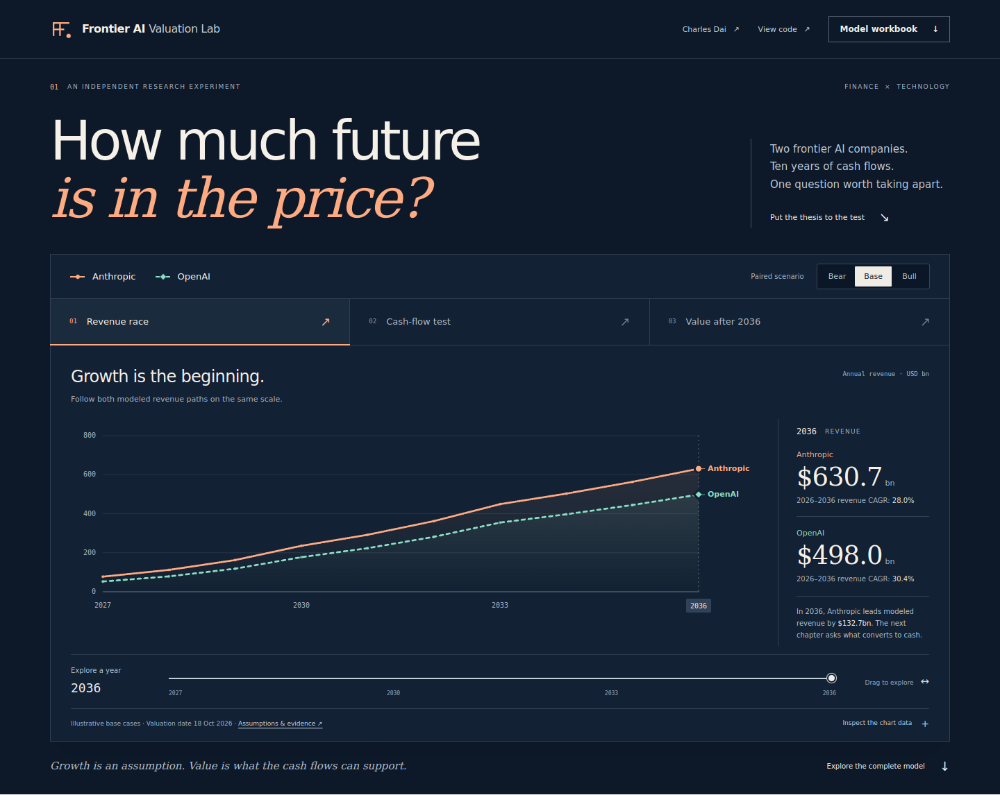

# Frontier AI Valuation Lab

**How much future is in the price? Explore two AI businesses through cash flows, capital requirements and explicit assumptions.**

[](https://github.com/ult666666/frontier-ai-valuation-lab/actions/workflows/ci.yml)

A full stack fintech research application by **Charles Dai**, Carnegie Mellon University. A guided visual comparison leads into paired stress tests, a complete valuation workstation, shareable scenarios and a downloadable brief. The deterministic JSON API, independently calculated Python reference, editable Excel model and dated source register make the financial reasoning inspectable. Research and implementation were developed with AI assistance and checked through reproducible calculations and tests.

**[Open the live demo](https://frontier-ai-valuation-lab.vercel.app)** · **[Read the review](https://frontier-ai-valuation-lab.vercel.app/report.html)** · **[Download the Excel model](https://frontier-ai-valuation-lab.vercel.app/downloads/Frontier_AI_Valuation_Model.xlsx)** · **[Portfolio](https://ult666666.github.io/)**

[PDF review](https://frontier-ai-valuation-lab.vercel.app/downloads/Frontier_AI_Valuation_Review.pdf) · [3.1 experience release](https://github.com/ult666666/frontier-ai-valuation-lab/releases/tag/v3.1.0) · [Verification record](docs/VERIFICATION.md)



## Try it in one minute

1. Open **Cash-flow test**, then **Value after 2036**. The same two scenarios tell a different story once revenue becomes cash flow and cash flow becomes present value.
2. In **Stress the thesis**, raise the cost of capital by **2 percentage points**. Under the Base assumptions, modeled EV moves from $367.8B to $265.3B for Anthropic and from $258.9B to $172.0B for OpenAI. Operating cash flows stay fixed.
3. Choose **Open this case in model**, inspect the annual reconciliation, then **Share this case** or download a **Scenario brief**.

Application **3.1.0** adds the experience and analytics layer. Financial engine **3.0.0**, the six published presets, the Excel/PDF review snapshot, and the **18 October 2026** research cutoff remain unchanged. This is a dated research model, not a live market feed.

## The problem

Private AI company headlines mix completed post-money equity valuations, proposed pre-money financings, annualized revenue, actual-period revenue and multiyear compute commitments. A spreadsheet can look precise while combining those quantities incorrectly. This project exposes the assumptions and arithmetic behind the comparison.

The application reports **illustrative operating enterprise value**. Private financing references appear separately with their dates and definitions. An optional equity bridge requires explicit hypothetical cash, debt and other-claim inputs.

## Explore the project

- **Guided comparison:** switch between modeled revenue, annual FCFF and signed value contributions; move the year slider and compare both businesses on one scale.
- **Paired stress tests:** change early growth, terminal margin, cost of capital and capital efficiency for both companies. View the result against the selected Bear/Base/Bull baseline and verify the complete calculation on the server.
- **Scenario workbench:** change growth, operating margins, capital efficiency, discount rate and terminal returns; inspect the full 2027–2036 forecast and remaining-2026 cash flow.
- **Valuation diagnostics:** inspect terminal-value concentration, cumulative operating deficit, a WACC/growth sensitivity grid, and the capital-return transition.
- **Reverse DCF:** solve for the early growth needed to reach a target EV. The solver finds multiple admissible solutions and tangent roots rather than assuming growth always raises value.
- **Auditable outputs:** export the current assumptions and forecast, save a scenario in the browser, and verify calculations through the server API.
- **Portable scenarios:** copy a versioned URL that restores the exact assumptions and optional hypothetical bridge. A script-free HTML brief includes the current forecast, reconciliation, diagnostics, sources and reopening link; it can be printed to PDF.
- **Financial evidence:** distinguish company disclosures, reported figures, analyst assumptions and accounting limitations at the point of use.
- **Editable workbook:** one scenario selector feeds both company forecasts; invalid assumptions suppress the affected output.

## Run locally

Requires **Node.js 24**. The application has **no npm runtime dependencies, API keys or database setup**.

```sh
git clone https://github.com/ult666666/frontier-ai-valuation-lab.git
cd frontier-ai-valuation-lab
npm test
npm start
```

Open `http://127.0.0.1:4321`. Use `PORT=8080 npm start` to choose a different port. Python 3.11+ is used for independent reference checks:

```sh
python3 tests/reference_parity.py
npm run build
```

The static `dist/` build also works on GitHub Pages or another static host. Browser calculations and exports remain available there; server verification requires the Node API and reports its availability explicitly.

## Architecture

| Component | Responsibility |
| --- | --- |
| `public/lib/model.js` | Pure FCFF engine, validation, sensitivities, accounting invariance and quartic reverse solver |
| `public/lib/analytics.js` | Shared paired comparisons, bounded stress transforms, milestones and individual driver effects |
| `public/experience.js` | Guided chart chapters, paired cases, stress controls and complete-result API verification |
| `public/app.js` | Browser controls, charts, local scenarios, exports and API verification |
| `public/lib/share.js` / `briefing.js` | Validated fragment links and standalone, recalculated scenario documents |
| `lib/http.js` | Bounded JSON requests and one Web-standard API handler |
| `api/index.js` | Vercel entry point for `/api/health` and `/api/valuation` |
| `server.js` | Local Node server using the same API handler and an allowlisted public directory |
| `data/` | Versioned presets, evidence records and fact provenance |
| `scripts/reference_model.py` | Independent Python forward calculation |
| `scripts/build_workbook.mjs` | Formula workbook authoring and validation in the documented artifact runtime |
| `tests/` | Financial regressions, real HTTP checks and cross-language parity |
| `.github/workflows/ci.yml` | Repeatable model/API/reference verification and static build |

The browser and server intentionally share their production model. Agreement between them establishes deployment consistency; the separate Python implementation and hand-calculated fixtures provide the independent arithmetic check.

## API example

```sh
curl http://127.0.0.1:4321/api/health
curl http://127.0.0.1:4321/api/valuation
curl -X POST http://127.0.0.1:4321/api/valuation \
  -H 'Content-Type: application/json' \
  -d '{"action":"value","assumptions":{"rev2026":100,"g1":0.04,"g2":0.04,"g3":0.04,"m27":0.2,"m30":0.2,"m36":0.2,"turns":2.5,"wacc":0.1,"tg":0.03,"roic":0.2,"stub":-3,"tax":0.25}}'
```

This fixture produces approximately **$200.3147B EV**. Amounts are USD billions; rates are decimals. Requests are limited to 16 KiB and sensitivity axes to nine values each. See [the API contract](docs/API.md).

The same endpoint also accepts **compare**, **stress** and **drivers**. Paired stress changes both selected cases using explicit percentage-point or percentage inputs. Invalid transformed assumptions are rejected; no value is silently clipped. Driver effects use named, different shock sizes and do not claim a probability distribution or causal attribution.

## What the review corrected

The October 16 predecessor had already repaired the original terminal cash flow, date treatment and unsupported cash bridge. This release preserves those corrections and fixes additional custom-input failures:

1. A valid low-margin scenario had two growth solutions for the same EV; the old solver incorrectly returned none.
2. The workbook accepted negative capital turns, creating artificial investment inflows while arithmetic checks could still say PASS.
3. Very large finite inputs could overflow into nonfinite outputs.
4. An editable terminal-year cell did not drive the forecast. The horizon is now explicitly fixed at 2036.

See [the audit](docs/AUDIT.md), [methodology](docs/METHODOLOGY.md) and [source provenance](docs/PROVENANCE.md). The research cutoff is **18 October 2026, 09:22 PDT**. Scenario labels carry no probability interpretation.

## Reproduce and update

Edit `data/presets.json` only when intentionally changing analyst assumptions. Refresh `data/research.json` and `data/fact-ledger.json` with dated evidence and definitions. Run model/API tests and Python parity before generating a new snapshot. `npm run build` checks model/research version agreement, regenerates the public JSON snapshots and stages only public files.

The committed workbook remains editable in Excel. Regenerating its presentation uses the optional `@oai/artifact-tool` authoring runtime described in its builder; this dependency is not required to run the application or reproduce the valuation math. The optional report PDF builder uses ReportLab. HTML/PDF/XLSX are release snapshots; editing one does not silently update the others.

## Limits

This is a research and engineering demonstration, not a verified security valuation or investment recommendation. Forecasts are illustrative. Audited current balance sheets, investor preference waterfalls, complete compute-payment schedules and comparable revenue accounting are unavailable. The discount rate, margins and terminal ROIC are assumptions. The model omits tax-loss carryforwards and uses aggregate net reinvestment rather than a full three-statement forecast. Peak cumulative economic FCFF deficit is not literal cash runway or a financing plan.

No brokerage connectivity, trade execution, personal financial records or paid model calls are present. Scenario saving uses the visitor's local browser storage. Company names identify the subject of independent research and do not imply affiliation or endorsement.

## License

Project code is available under [MIT](LICENSE). Linked third-party publications and trademarks remain with their respective owners.
