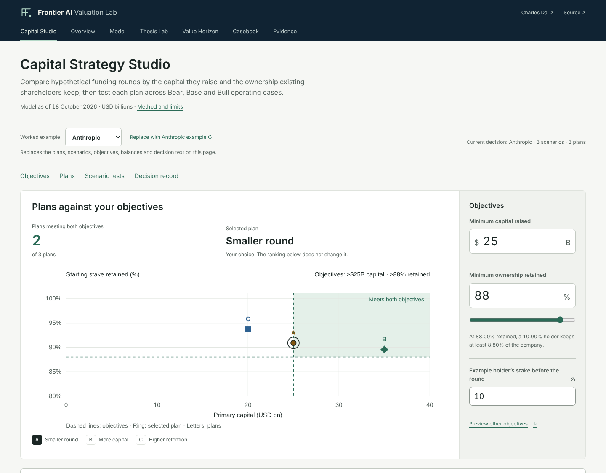

# Frontier AI Valuation Lab

[](https://github.com/ult666666/frontier-ai-valuation-lab/actions/workflows/ci.yml)

A discounted cash flow (DCF) model of Anthropic and OpenAI under illustrative Bear, Base and Bull assumptions. On top of it, the Capital Strategy Studio compares hypothetical funding rounds: how much capital each raises, how much ownership existing shareholders keep, and what their stake is worth in each case.

It is written for finance and engineering readers who want to see how a private-company valuation is built and how a funding round changes the numbers. The figures rest on public data as of 18 October 2026 and on assumptions you can edit. They are not valuations of either company.



## Try it

Open the [worked decision](https://frontier-ai-valuation-lab.vercel.app/capital.html#worked-decision) in the live app, or run it locally with Node.js 24 (see [`.nvmrc`](.nvmrc)) and Python 3.11 or newer:

```sh
git clone https://github.com/ult666666/frontier-ai-valuation-lab.git
cd frontier-ai-valuation-lab
npm test
npm start    # then open http://127.0.0.1:4321/capital.html#worked-decision
```

There are no npm dependencies, API keys or databases. `PORT=8080 npm start` picks another port.

## What it computes

| Page | What it computes |
| --- | --- |
| [Model](https://frontier-ai-valuation-lab.vercel.app/index.html#workspace) | Free cash flow to the firm (FCFF) from 13 assumptions, enterprise value (EV), a WACC by terminal growth sensitivity grid, a reverse DCF for the growth a target EV needs, and an equity bridge with one primary round. |
| [Monte Carlo](https://frontier-ai-valuation-lab.vercel.app/index.html#uncertainty) | Percentiles of value from correlated ranges on growth, margin, WACC, terminal growth and (with an equity bridge) dilution, the share of draws above a hurdle, and a P10 to P90 tornado. |
| [Capital Strategy Studio](https://frontier-ai-valuation-lab.vercel.app/capital.html#worked-decision) | Which hypothetical rounds meet a capital and ownership objective, the value of existing shareholders' stake in each case, minimax regret, break-even equity values, and an exportable decision record. |
| [Thesis Lab](https://frontier-ai-valuation-lab.vercel.app/thesis.html) | How six groups of assumptions account for the EV difference between two cases (grouped Shapley values over all 64 combinations), and a WACC by 2036 margin value grid. |
| [Value Horizon](https://frontier-ai-valuation-lab.vercel.app/horizon.html) | EV when only 0 to 100 years of cash flow after 2036 are kept, and the horizon a target EV requires. |
| [Casebook](https://frontier-ai-valuation-lab.vercel.app/casebook.html) | Saved cases and comparisons with notes and sources, stored in the browser and exported as JSON or a brief. |
| [Evidence](https://frontier-ai-valuation-lab.vercel.app/index.html#sources) | 19 dated sources, each labelled as a company disclosure, reported evidence or a method source, with what it supports and its limit. |

### The worked decision

The Studio opens on three hypothetical primary rounds for Anthropic, tested against two objectives: raise at least $25B, and let existing shareholders keep at least 88% of their stake. Amounts are USD billions.

| Plan | Pre-money valuation | Capital raised | Ownership retained | Meets both objectives |
| --- | ---: | ---: | ---: | --- |
| A · Smaller round | 250 | 25 | 90.91% | Yes |
| B · More capital | 300 | 35 | 89.55% | Yes |
| C · Higher retention | 300 | 20 | 93.75% | No, $5B short |

The value to existing shareholders is ownership retained × (equity value before the round + capital raised). Plans A and B give the same value when equity before the round is $635B; below that B gives more, above it A does. The [walkthrough](docs/DEMO_WALKTHROUGH.md) follows the whole decision step by step.

### Monte Carlo through the API

The browser and the API run the same engine. With the server running, this request simulates the Anthropic Base case with ranges on four drivers:

```sh
curl --fail-with-body http://127.0.0.1:4321/api/valuation \
  -H 'Content-Type: application/json' \
  -d '{"action":"simulate","assumptions":{"rev2026":53.26,"g1":0.45,"g2":0.24,"g3":0.12,"m27":-0.02,"m30":0.18,"m36":0.22,"turns":2.5,"wacc":0.125,"tg":0.03,"roic":0.2,"stub":-3,"tax":0.25},"bridge":null,
       "drivers":[{"key":"growth","distribution":{"type":"triangular","min":0.7,"mode":1,"max":1.3}},
                  {"key":"m36","distribution":{"type":"triangular","min":0.16,"mode":0.22,"max":0.28}},
                  {"key":"wacc","distribution":{"type":"normal","mean":0.125,"sd":0.015,"min":0.095,"max":0.155}},
                  {"key":"tg","distribution":{"type":"triangular","min":0.02,"mode":0.03,"max":0.04}}],
       "correlation":[[1,0.4,0,0],[0.4,1,0,0],[0,0,1,0.3],[0,0,0.3,1]],"draws":10000,"seed":20261018,"hurdle":300}'
```

It returns a median of $364.2B (P5 $197.2B, P95 $694.6B) against a deterministic Base value of $367.8B, with 69.5% of draws above the $300B hurdle. The same seed gives byte-identical JSON in the browser. Every action is described in the [API contract](docs/API.md).

## How it works

- One set of pure JavaScript modules in [`public/lib`](public/lib) runs in the browser and behind the Node API ([`lib/http.js`](lib/http.js), deployed as a Vercel function from [`api/index.js`](api/index.js)).
- The FCFF engine discounts from the valuation date, charges growth for its reinvestment and keeps enterprise value separate from equity. See the [valuation method](docs/METHODOLOGY.md).
- Each tool has a pure calculation module and its own method note: [capital strategy](docs/CAPITAL_STRATEGY.md), [financing and ownership](docs/FINANCING_LENS.md), [Monte Carlo](docs/UNCERTAINTY.md), [Thesis Lab](docs/THESIS_LAB.md) and [Value Horizon](docs/VALUE_HORIZON.md).
- The Monte Carlo simulation uses a seeded xoshiro128\*\* generator. It and Value Horizon use fdlibm ports of `exp`, `log`, `expm1` and `log1p`, so the browser and the API return the same bits, which CI checks in Chromium.
- Seven Python reference checks recompute the model and the analysis tools independently, and CI runs all of them.
- Shared links, JSON records and HTML briefs carry every input. Imports are validated and recalculated rather than trusted.

[Architecture](docs/ARCHITECTURE.md) covers state, validation, exports and deployment.

```text
public/            pages, page scripts and styles
public/lib/        the calculation modules shared by the browser and the API
public/downloads/  worked briefs, records, the Excel model and the original review
lib/http.js        the API handler for the local server and the Vercel function
scripts/           Python reference checks and the builders for the downloads
tests/             Node tests (*.test.js) and browser suites (*-browser.mjs)
docs/              method notes, architecture, testing and the verification record
```

## Build and test

```sh
npm test         # Node unit and HTTP tests (Node.js 24)
npm run build    # writes the static site to dist/
python3 -B scripts/check_capital_reference.py --output /tmp/capital-reference.json
```

[docs/TESTING.md](docs/TESTING.md) lists all seven Python reference checks, the 13 browser suites and what CI runs on every push.

## Limits

- Company forecasts are illustrative assumptions, not company guidance. Funding-round terms, balances and objectives are hypothetical inputs.
- Each funding round is one primary issue with equal rights, no fees, preferences or option pools, and operations that do not change with the new cash.
- Scenarios and Monte Carlo ranges are not calibrated probabilities. Results describe the inputs, not likely outcomes.
- The committed Excel workbook cannot be rebuilt from this repository, because its generator depends on a tool that is not on the public npm registry.
- Nothing here is investment advice, and the project is not affiliated with or endorsed by Anthropic or OpenAI.

## Method sources

- [RAND, Robust Decision Making](https://www.rand.org/pubs/tools/TL320/tool/robust-decision-making.html): separating decisions, futures and performance measures, without reading scenario counts as probabilities.
- [Aswath Damodaran, Probabilistic Approaches](https://pages.stern.nyu.edu/~adamodar/pdfiles/papers/probabilistic.pdf): coherent scenarios and the difference between scenario values and expected values.
- [HM Treasury, The Green Book (2026)](https://www.gov.uk/government/publications/the-green-book--2/the-green-book-2026): explicit objectives, options and sensitivity testing. Its public-sector conventions are not used as financing rules.

Each method note cites its own sources.

## More

- [Documentation index](docs/README.md): method notes, architecture, the walkthrough and the desktop package.
- [Verification record](docs/VERIFICATION.md): dated test, reference and browser runs for each release.
- [Changelog](CHANGELOG.md) and [releases](https://github.com/ult666666/frontier-ai-valuation-lab/releases).
- Downloads: the [worked decision brief](https://frontier-ai-valuation-lab.vercel.app/downloads/Frontier_AI_Capital_Decision.html), the [Excel model](public/downloads/Frontier_AI_Valuation_Model.xlsx) and the [original financial review (PDF)](public/downloads/Frontier_AI_Valuation_Review.pdf).
- [Portfolio case study](https://ult666666.github.io/projects/frontier-ai-valuation-lab.html).

Built by Charles Dai (Carnegie Mellon University) with AI coding assistants. The tests and reference checks in [docs/TESTING.md](docs/TESTING.md) are how the results are checked.

Code is [MIT licensed](LICENSE). Linked third-party research belongs to its publishers.
