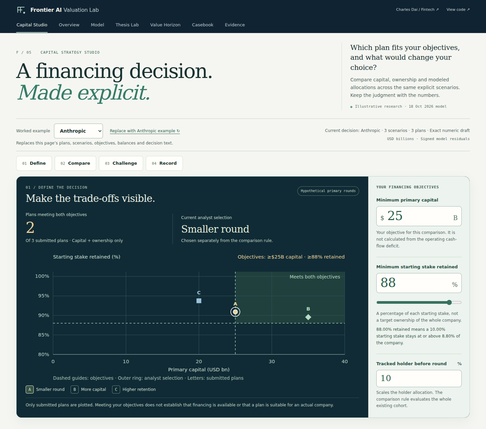

# Frontier AI Valuation Lab

[](https://github.com/ult666666/frontier-ai-valuation-lab/actions/workflows/ci.yml)

An interactive valuation and capital-decision studio for illustrative Anthropic and OpenAI scenarios. A discounted cash flow (DCF) model values each company under Bear, Base and Bull cases built on public-data assumptions. The Capital Strategy Studio then compares hypothetical funding rounds: how much capital each one raises, how much of their stake existing holders keep, and how each plan holds up across the cases.

**Open first:** the [worked decision in Capital Strategy Studio](https://frontier-ai-valuation-lab.vercel.app/capital.html#worked-decision). It tests three hypothetical rounds against two goals: raise at least $25B, and let existing holders keep at least 88% of their starting stake. The [company model](https://frontier-ai-valuation-lab.vercel.app/) shows the cash flows behind each case.

**Run it locally** with Node.js 24 (the version in [`.nvmrc`](.nvmrc)). The test suite also needs Python 3.11 or newer.

```sh
git clone https://github.com/ult666666/frontier-ai-valuation-lab.git
cd frontier-ai-valuation-lab
npm test
npm start    # then open http://127.0.0.1:4321/capital.html#worked-decision
```

The company figures rest on illustrative assumptions and incomplete public disclosures. They are not current valuations of either company or investment advice, and the project is not affiliated with or endorsed by Anthropic or OpenAI. Charles Dai (Carnegie Mellon University) built it with AI assistance.



More: [fintech portfolio](https://ult666666.github.io/fintech.html) · [engineering case study](https://ult666666.github.io/projects/frontier-ai-valuation-lab.html) · [walkthrough](docs/DEMO_WALKTHROUGH.md) · worked decision as [PDF](https://frontier-ai-valuation-lab.vercel.app/downloads/Frontier_AI_Capital_Decision.pdf), [HTML](https://frontier-ai-valuation-lab.vercel.app/downloads/Frontier_AI_Capital_Decision.html) or [JSON](https://frontier-ai-valuation-lab.vercel.app/downloads/Frontier_AI_Capital_Decision.json) · [portable desktop package (ZIP)](https://frontier-ai-valuation-lab.vercel.app/downloads/Frontier_AI_Capital_Strategy_Package.zip)

## Try a complete decision

The worked illustration compares three primary rounds. All figures are **USD billions**. Quotes are independently entered hypothetical prices. Retention is the fraction of starting ownership kept by an existing holder who does not subscribe for more shares.

| Plan | Pre-money quote | Primary capital | Starting stake retained | Meets $25B capital and 88% retention? |
| --- | ---: | ---: | ---: | --- |
| A · Smaller round | 250 | 25 | 90.91% | Yes |
| B · More capital | 300 | 35 | 89.55% | Yes |
| C · Higher retention | 300 | 20 | 93.75% | No: $5B below the capital objective |

1. **Define.** Open [Try the tradeoff](https://frontier-ai-valuation-lab.vercel.app/capital.html#capital-explore). Preview **$25B / 90%**: only A meets both objectives in the worked example. Preview **$30B / 90%**: none qualifies. Preview **$30B / 88%**: B qualifies. Each preview uses your current submitted plans; choose **Apply** to update the two objectives together.
2. **Compare.** Apply **$25B / 88%** again to compare A and B in the worked example. Inspect individual plan markers, exact pricing and the equivalent table. A capital shortfall, an ownership constraint and an invalid input have different meanings.
3. **Challenge.** Evaluate the same plans against Bear, Base and Bull operating cases, or edit every assumption and continuation horizon. For A and B, the signed modeled existing-cohort allocations cross at **$635B of pre-money modeled equity residual**, with **$600B** allocated to the cohort. B allocates more below that switching value; A allocates more above it.
4. **Record.** Choose a plan deliberately, explain its tradeoff, name information still needed and set a review trigger. Export an exact decision link, JSON record or script-free brief. Imported output is recalculated from the inputs.

Previewing preserves the exact decision, its analyst text and its verification state. Applying a different pair preserves all plan terms and scenarios, recalculates the complete decision, and marks existing reasoning and API verification for review. Editing the draft clears an old preview. The [preview helper](public/lib/capital-objectives.js) composes the same validated record and calculation engine used by the rest of the application.

The default hypothetical bridge assumes cash of 20, debt of 5 and no other claims. The default capital objective is an analyst input, not an estimate of either company's cash requirement. See the [worked mathematics, numeric conventions and limits](docs/CAPITAL_STRATEGY.md).

## Four disciplines, one product

| Discipline | What the demo makes inspectable | Implementation and evidence |
| --- | --- | --- |
| **Fintech** | Operating EV, modeled equity residual, independently entered financing price, primary proceeds and ownership have separate definitions. | [Capital method](docs/CAPITAL_STRATEGY.md), [financing method](docs/FINANCING_LENS.md), preserved [FCFF engine](public/lib/model.js) |
| **Quant** | Finite-scenario regret, dominance, pairwise switching values and all-scenario model-conditioned pricing intervals. No scenario probabilities are invented. | [Pure calculation](public/lib/capital-strategy.js), [independent Python reference](scripts/check_capital_reference.py), [boundary tests](tests/capital-strategy.test.js) |
| **Engineering** | Complete state flows through the browser, bounded stateless API, exact share codec, import validation and standalone outputs. Late responses cannot verify newer inputs. | [Architecture](docs/ARCHITECTURE.md), [API contract](docs/API.md), [HTTP checks](tests/capital-api.test.js), [browser workflow](tests/capital-browser.mjs) |
| **Business** | An explicit objective, alternative plans, a declared comparison metric, analyst preference, tradeoff, information needs and review trigger. | [Worked decision](https://frontier-ai-valuation-lab.vercel.app/downloads/Frontier_AI_Capital_Decision.html), [walkthrough](docs/DEMO_WALKTHROUGH.md), [portfolio case study](https://ult666666.github.io/projects/frontier-ai-valuation-lab.html) |

The selected comparison metric is `retention × (modeled pre-money residual + primary proceeds)`. It allocates a signed modeled residual under equal economic rights, unchanged operations, retained cash and zero fees. It is not an investment return or a limited-liability common-share price.

Only plans meeting the capital and retention objectives enter regret and dominance comparisons. Minimax identifies the smallest maximum gap to the eligible best across the submitted cases and returns all ties. It never changes the analyst's selection. A finite set of cases does not establish global robustness.

The **model-conditioned pricing interval** is a separate diagnostic. Every submitted scenario must meet the chosen modeled-value-to-quote ratio, while the quote must also preserve the ownership floor. The default Bear residual makes the interval empty for all three entered raises. That conflict remains visible even though A and B meet the capital and ownership objectives.

## Run the complete stack locally

The commands at the top run the tests and start the server. Node.js 24 is the supported version for serving, building and testing. On an older Node.js, `npm test` stops with a message asking for Node.js 24; `nvm use` switches to the version in `.nvmrc`. The test suite also needs **Python 3.11+** for desktop-package verification. The application has **zero npm runtime dependencies**, and needs no API key, account, database or paid data feed.

To choose another port, use `PORT=8080 npm start`. The same Web-standard HTTP handler runs locally and in the Vercel function. `npm run build` creates the public application in `dist/`.

Python 3.11+ and Node 24 reproduce the independent references:

```sh
python3 -B scripts/check_capital_reference.py --output /tmp/capital-reference.json
python3 -B tests/reference_parity.py
python3 -B scripts/check_horizon_reference.py --output /tmp/horizon-reference.json
python3 -B scripts/check_financing_reference.py --output /tmp/financing-reference.json
python3 -B scripts/check_ownership_reference.py --output /tmp/ownership-reference.json
python3 -B scripts/check_thesis_reference.py --output /tmp/thesis-reference.json
```

The capital reference uses separate arithmetic and declares its tolerances and tested cases. Browser/API agreement is a deployment and state-transport check, not an independent proof of the formulas. Current and historical evidence are distinguished in the [verification record](docs/VERIFICATION.md).

### Make an exact API request

With the local server running, prepare the public worked example's numeric snapshot:

```sh
node --input-type=module <<'JS'
import {readFile,writeFile} from 'node:fs/promises';
const record=JSON.parse(await readFile('public/downloads/Frontier_AI_Capital_Decision.json','utf8'));
await writeFile('/tmp/frontier-capital-request.json',JSON.stringify({action:'capital',snapshot:record.snapshot}));
JS
curl --fail-with-body http://127.0.0.1:4321/api/valuation \
  -H 'Content-Type: application/json' \
  --data-binary @/tmp/frontier-capital-request.json
```

A successful response includes `appVersion`, `modelVersion`, `valuationDate` and the **complete** capital analysis. The numeric request excludes analyst prose. The endpoint accepts 1–9 complete scenarios and 1–6 plans, rejects unsupported fields, validates every input, and retains the existing **16 KiB** streamed request limit. See [all endpoints, boundaries and status meanings](docs/API.md).

The Studio distinguishes **exact verification**, a **qualified rounding comparison**, and a mismatch. Browser and server math libraries can approximate finite-continuation functions differently. The qualified state permits a small relative difference only in named modeled outputs; every input, quoted term, eligibility result and comparison status must remain exact. It does not change the current record or exports. See the [comparison policy](docs/CAPITAL_STRATEGY.md#10-browser-and-api-comparison), [pure comparator](public/lib/capital-verification.js) and [captured-runtime regression tests](tests/capital-verification.test.js).

## Continue into the financial foundations

The original research workflow remains connected through seven navigation destinations: Capital Studio, Overview, Model, Thesis Lab, Value Horizon, Casebook and Evidence.

| Workspace | Question | Open |
| --- | --- | --- |
| **Overview and Model** | What operating assumptions and annual cash flows support the valuation? | [Company comparison](https://frontier-ai-valuation-lab.vercel.app/), [complete model](https://frontier-ai-valuation-lab.vercel.app/index.html#workspace) |
| **Financing Lens and Ownership Frontier** | How does one hypothetical primary round translate price into cash and ownership? | [Worked ownership example](https://frontier-ai-valuation-lab.vercel.app/index.html#ownership-example), [method](docs/OWNERSHIP_FRONTIER.md) |
| **Value Horizon** | How much value depends on cash flows after the explicit forecast? | [Finite continuation tool](https://frontier-ai-valuation-lab.vercel.app/horizon.html), [method](docs/VALUE_HORIZON.md) |
| **Thesis Lab** | Which declared assumption groups account for the difference between two operating cases? | [Exact attribution and target landscape](https://frontier-ai-valuation-lab.vercel.app/thesis.html), [method](docs/THESIS_LAB.md) |
| **Research Casebook** | Why keep an operating case, and what would change the argument? | [Saved research](https://frontier-ai-valuation-lab.vercel.app/casebook.html), [workflow guide](docs/RESEARCH_WORKSPACE.md) |
| **Evidence** | What was disclosed, reported or assumed, and when? | [Source register](https://frontier-ai-valuation-lab.vercel.app/index.html#sources), [provenance](docs/PROVENANCE.md) |

Value Horizon keeps the explicit forecast fixed and retains 0–100 annual continuation cash flows after 2036, with zero residual after the chosen cutoff. Thesis Lab uses all 64 group combinations for exact grouped Shapley attribution across six declared groups, equivalent to averaging 720 orders. The Casebook preserves existing operating-case and comparison schemas; capital decisions have their own record type.

## Research scope and method sources

The company data has a valuation date of **18 October 2026**. The capital decision tools were added on top of the financial engine, the financing and ownership engines, the six company presets, the dated research register, the original Excel workbook and the original review PDF without changing them. Versions and dated evidence are in the [GitHub releases](https://github.com/ult666666/frontier-ai-valuation-lab/releases).

- [RAND: Robust Decision Making](https://www.rand.org/pubs/tools/TL320/tool/robust-decision-making.html) informs the separation of decision levers, explicit futures and performance measures, and the caution against interpreting scenario counts as probabilities. This demo is a finite comparison, not a complete RDM implementation.
- [Aswath Damodaran: Probabilistic Approaches](https://pages.stern.nyu.edu/~adamodar/pdfiles/papers/probabilistic.pdf) informs coherent scenario assumptions and the distinction between scenario-specific values and probability-weighted expectations.
- [HM Treasury: The Green Book (2026)](https://www.gov.uk/government/publications/the-green-book--2/the-green-book-2026) informs explicit objectives, alternative options, sensitivity and documented judgment. Its public-sector appraisal conventions are not used as private-company financing rules.

Financing examples do not establish either company's balance sheet, cap table, funding need or available offers. The simple primary issuance excludes transaction fees, preferences, options, conversions, secondary sales, spending-related changes to operations and later rounds. Economic FCFF is not a treasury cash schedule. Negative modeled values remain signed.

## Review and deliverables

- [Verification and limits](docs/VERIFICATION.md) lists the local test runs, Python reference checks, browser checks and AI-assisted reviews behind each release.
- [Architecture and trust boundaries](docs/ARCHITECTURE.md) explains exact state, validation, API parity, portable records and deployment.
- [Desktop guide](docs/DESKTOP_GUIDE.md) explains the versioned package and local reproduction.
- [Reviewed Excel model](public/downloads/Frontier_AI_Valuation_Model.xlsx) and [original financial review](public/downloads/Frontier_AI_Valuation_Review.pdf) retain the reviewed baseline. The workbook is a committed file. Its generator, `scripts/build_workbook.mjs`, needs `@oai/artifact-tool`, which comes from the Codex agent environment used to build this project and is not on the public npm registry, so visitors cannot rerun the generator.
- [GitHub releases](https://github.com/ult666666/frontier-ai-valuation-lab/releases) preserve dated handoffs and downloadable evidence.

Code is [MIT licensed](LICENSE); linked third-party research remains with its publishers.
