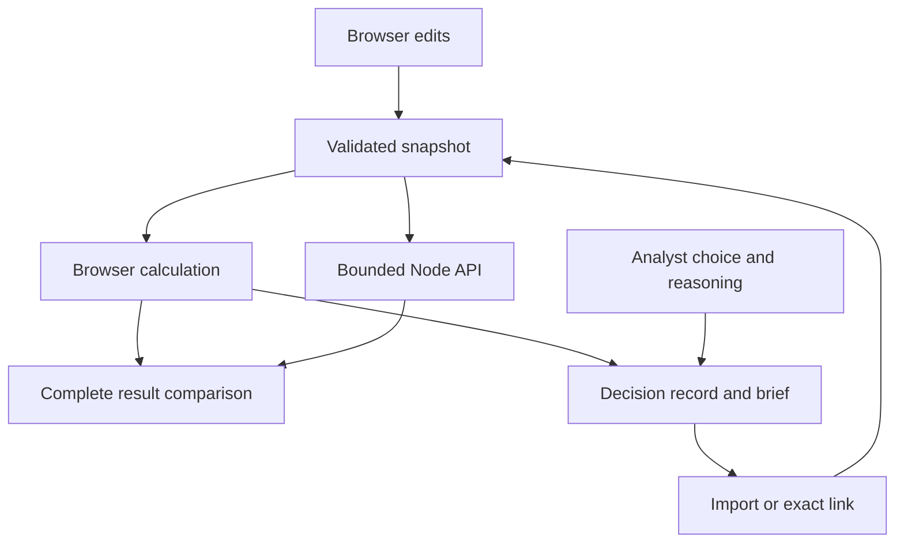

# Architecture and trust boundaries

Capital Strategy Studio is an application workflow around the existing deterministic financial engines. Application 4.0.0 adds capital method 1.0.0; it preserves financial engine 3.0.0 and the 18 October 2026 model date.

## One complete decision state

The calculation consumes one detached, strict snapshot: company context, named operating scenarios, submitted financing plans, policy objectives and an explicit hypothetical equity bridge or `null`. The analyst's selection and four reasoning fields are a separate decision object. Each record contains both and a recomputed analysis.

The browser and API import the same pure calculation module. They are two execution contexts, not two independent financial methods. A separate Python reference and hand-derived fixtures challenge the arithmetic independently. Agreement on the complete result establishes that the submitted state and deployed calculation align within the checked path.

## Module boundaries

| Component | Responsibility | Intentionally outside its scope |
| --- | --- | --- |
| `model.js` | Dated economic FCFF, reinvestment, discounting, terminal returns and optional equity bridge | Round pricing and cash-runway estimation |
| `horizon.js` | Finite continuation after 2036, with zero residual after the cutoff | Company lifespan probabilities or investment holding-period returns |
| `financing.js` / `ownership.js` | Primary-round quote interpretation, share issuance and fixed-quote ownership constraint | Preference waterfalls, options, fees and subsequent rounds |
| `capital-strategy.js` | Strict capital snapshot, scenario-plan matrix, eligibility, regret, dominance, switching values and pricing intervals | Probability weights, raising capital to improve operations, automatic analyst selection |
| `capital.js` / `capital-chart.js` | Draft editing, equivalent visual/table presentation, revision-bound verification and export controls | Trusted calculation results from imported files |
| `capital-record.js` / `capital-share.js` | Strict versioned inputs, bounded Unicode-safe transport and recomputation | Authentication, signatures or confidential link sharing |
| `capital-brief.js` | Script-free, escaped narrative and exact input/output report | Executing imported markup or claiming a past API verification remains valid |
| `lib/http.js` | Web-standard stateless request handler shared by Node and Vercel | Persisting analyst prose or providing financial-data credentials |

## Data and numerical boundaries

Every scenario supplies all thirteen financial assumptions. A rejected scenario rejects the input snapshot; the engine does not filter unsuccessful cases to improve the result. Missing bridges remain unavailable. An explicit zero bridge is an analyst assumption. Negative residuals remain signed, and incomplete numerical comparisons return explicit unavailable states.

The snapshot allows 1–9 scenarios and 1–6 plans. This bounds the cross-product at 54 allocation cells and 15 pairwise switching comparisons. Each plan also receives the existing bounded ownership analysis. Complete input validation precedes calculation. Ordinary ties and thresholds use a documented 32 × Number.EPSILON relative band; the 100% retained-stake boundary remains strict for any positive new capital. Derived overflow and unresolved precision are distinct from an economic zero. The [capital method](CAPITAL_STRATEGY.md) defines the complete arithmetic contract.

The `capital` API accepts only `action` and `snapshot`. The existing parser enforces `application/json`, fatal UTF-8 decoding and a 16 KiB byte limit while streaming, without relying on the client-declared content length. Validation failures return HTTP 400; unsupported media returns 415 and oversize input returns 413. Successful calculations, including valid unavailable or empty outcomes, return the complete versioned result. No response serializes Infinity or NaN. See [API.md](API.md).

## Browser verification lifecycle

A financial edit changes the revision and invalidates the previous API status. An in-flight request is cancelled. Before accepting a response, the controller checks that it belongs to the current revision and compares the complete result and version envelope. Merely receiving HTTP 200 is insufficient. An invalid draft clears dependent outputs and disables misleading calculation exports and verification.

Analyst prose is excluded from the calculation API. Changing the financial basis marks existing reasoning for review without silently rewriting the text or changing the selected plan. The UI distinguishes the analyst's preference from the declared minimax result, including when the chosen plan no longer meets the current objectives.

## Import, sharing and text

A decision JSON file is limited to 256 KiB of UTF-8. Its schema, financial model/date, capital version, input shape and selected-plan reference are checked. Supplied analysis is discarded and recalculated. Import preview precedes applying the candidate; failed imports preserve the current draft.

Share tokens use UTF-8 base64url with bounds on encoded characters and decoded bytes. Numeric values are serialized from the actual state, not rounded screen labels. Unicode reasoning and HTML-like text remain text. A valid decision too large for a share link still has a JSON export path. An exported brief is script-free and escapes authored text.

A link is portable, not private. Its fragment contains the decision inputs and analyst text; anyone given it can read them. The application does not automatically send those fragments to the calculation endpoint. Browser history, explicit copying and the host's ordinary access logging have their own scope. There is no claim that a record is signed, immutable or authenticated.

The Studio does not silently persist drafts or change the existing Research Casebook. The Casebook retains its own versioned operating-case/comparison records, local storage behavior and export/import semantics.

## Rendering and access

The plan chart shows discrete submitted offers, a capital-objective guide and a retained-stake guide. It does not connect offers into an apparently available financing frontier. Text labels, marker distinctions and equivalent tables convey the classification. Visible input labels identify money, decimal model fractions and displayed percentages. Native controls support keyboard use; responsive verification covers narrow viewports and 200% zoom. Reduced-motion preferences are honored.

Browser and visual checks cover the exercised Chromium environment. They do not certify every browser, physical device or assistive technology. A readable static introduction and standalone brief remain available without running the interactive calculation.

## Build and deployment

The app has no npm runtime dependencies. `server.js` serves the explicit public directory and delegates API paths to `handleRequest`. The Vercel function uses the same handler. The build checks release/model metadata, generates dated public JSON snapshots and copies approved public file types into `dist/`. Repository source and local verification material do not belong in that static payload.

The separate portfolio has an exact public-file inventory and a create-once staged build. Its new Capital Studio capture is deliberately added to that inventory. The existing staged-byte verification, symlink and hardlink rejection, pinned CI actions, read-only verification permissions and main-only Pages deployment are preserved. [Portfolio publication boundary](https://github.com/ult666666/ult666666.github.io/blob/main/docs/PUBLICATION_BOUNDARY.md).

CI runs financial/API regression checks, independent references and the public build. Local release evidence additionally covers real browser workflows, rendered PDFs, package membership and exact hashes. Production HTTPS, browser behavior, deployment commit and downloaded release assets are verified separately after publication. Source hashes tie a receipt to the bytes it inspected; they are not a cryptographic signature or proof of financial forecast accuracy.

## Inspect or reproduce

Start with the [walkthrough](DEMO_WALKTHROUGH.md), [API contract](API.md), [capital method](CAPITAL_STRATEGY.md) and [verification record](VERIFICATION.md). The README provides the minimal Node 24 start command and independent Python reference commands. No paid service, database or financial-account integration is required.
