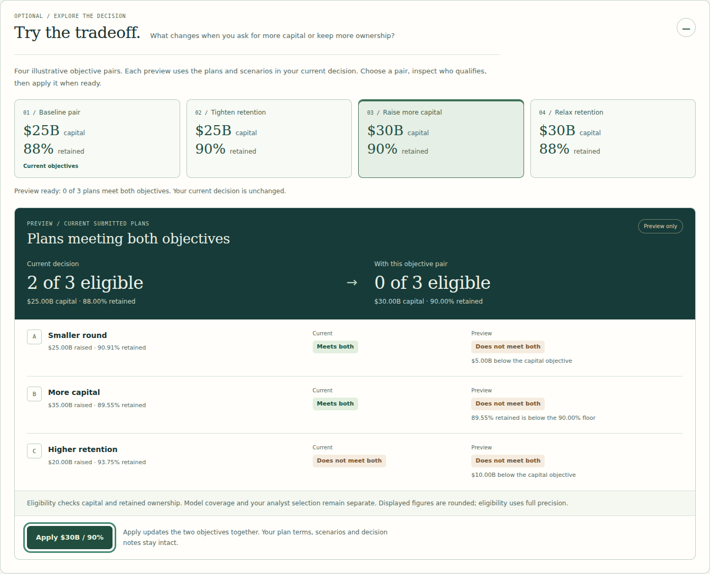

# Capital Strategy Studio: a complete demonstration

This walkthrough uses the published deterministic example. It demonstrates the product, its financial definitions, quantitative comparisons, software boundaries and the analyst's business judgment. All round terms and the common equity bridge are hypothetical. Amounts are USD billions.

**Start:** [Capital Strategy Studio · worked decision](https://frontier-ai-valuation-lab.vercel.app/capital.html#worked-decision). Locally: `http://127.0.0.1:4321/capital.html#worked-decision` after `npm start`.

## 1. Define a business objective

The default objective is to raise at least 25 while retaining at least 88% of starting ownership. A tracked holder starts with 10%; an 88% retention floor therefore requires at least 8.8% company ownership after the round. The capital objective is entered explicitly, never inferred from the model's economic FCFF deficit.

| Plan | Quote basis | Quote | Raise | Existing-cohort retention |
| --- | --- | ---: | ---: | ---: |
| A · Smaller round | Pre-money | 250 | 25 | 250 / 275 = 90.9091% |
| B · More capital | Pre-money | 300 | 35 | 300 / 335 = 89.5522% |
| C · Higher retention | Pre-money | 300 | 20 | 300 / 320 = 93.75% |

A and B meet both objectives. C raises 5 less than required. The chart shows three separate markers and a region defined by the two objective guides. The equivalent table exposes the same calculation.

## 2. Make a conflict visible

Open the optional [Try the tradeoff panel](https://frontier-ai-valuation-lab.vercel.app/capital.html#capital-explore), below the main decision chart. Choose an objective pair to see current and preview eligibility alongside every submitted plan and its reason for passing or missing the two objectives.

*Actual product capture, 20 October 2026. The current $25B / 88% decision remains unchanged until Apply is selected.*

| Preview pair | Eligible plans in the unchanged worked example | What the conflict shows |
| --- | --- | --- |
| $25B / 88% | A and B | Two submitted offers meet both objectives. |
| $25B / 90% | A | B misses the tighter ownership floor; C still raises too little. |
| $30B / 90% | None | No submitted offer satisfies both objectives. |
| $30B / 88% | B | The lower ownership floor admits the larger round. |

Previewing alone does not change the draft, exact exports, link or API verification. Choose **Apply** to change the capital objective and retained-stake floor together. All plan terms, operating scenarios, balances, holder and coverage settings, analyst selection and exact prose are preserved. A changed objective requires new API verification and review of existing reasoning. A pair already in use has a disabled Apply action.

The preview follows your current inputs, including renamed or edited plans and imported/shared decisions. Any subsequent draft edit clears it, and an invalid draft pauses previewing. A missing equity bridge still permits capital and retention screening while allocation comparisons remain unavailable. You can also edit either objective directly in the main controls.

Explicitly apply the original **$25B / 88%** pair before continuing to the A/B scenario comparison. The panel never restores an earlier pair or chooses an analyst preference automatically.

This is a finite comparison of the submitted plans, not a claim that no other financing could work. Add or edit a plan to test another set of terms. A valid plan that misses an objective remains in the analysis; an invalid quote is identified separately and suppresses dependent outputs until corrected.

## 3. Challenge the modeled consequences

The example uses the frozen Anthropic Bear, Base and Bull cases with perpetual continuation, plus hypothetical pre-round cash 20, debt 5 and other claims0. Each case's modeled pre-money residual is operating EV + 15.

| Case | Operating EV | Modeled pre-money equity residual |
| --- | ---: | ---: |
| Bear | −13.1619 | 1.8381 |
| Base | 367.7713 | 382.7713 |
| Bull | 1,884.3088 | 1,899.3088 |

These are model outputs, not company disclosures. Values are rounded here; JSON retains the full binary64 values. Every plan receives the same scenario and bridge.

The declared metric is the signed residual allocated to the existing cohort after a primary round: `r × (M + R)`, where r is retained ownership, M is modeled pre-money residual and R is primary capital. New capital stays cash; operations do not improve merely because the raise is larger. Negative residual allocations are not limited-liability share valuations.

For each case, regret is the difference from the largest allocation among eligible plans. The default minimax result is A: its largest gap is approximately 8.5911 in Bear, compared with B's approximately 17.1548 in Bull. This finite-scenario result neither assigns probabilities nor overrides the analyst's preference.

### Explain the switching value

For the two eligible plans:

`A(M) = (10/11) × (M + 25)`

`B(M) = (60/67) × (M + 35)`

Setting the expressions equal gives M=635; each allocates600 to the existing cohort. Below635, B has the larger allocation; above635, A does. This is a conditional threshold for these entered terms, with operating assumptions varying through M. It is not a price target, operating EV or expected outcome. The software reports a floating-point result near635 with documented tie conventions; the rational fixture independently establishes the hand calculation.

### Test the separate pricing interval

Open the model-conditioned pricing interval. At a model/quote floor of 1×, every case must have M at least as large as the pre-money quote. The Bear case limits that quote to approximately 1.8381. Plan A's25 raise at88% retention requires at least 183.3333 pre-money. The interval is empty. B and C also have empty intervals.

The capital/retention screen and this model-conditioned diagnostic answer different questions. A and B can meet the first pair of objectives while all three plans fail the additional all-scenario pricing conditions. The tool does not silently add the latter condition to plan eligibility or present the analytical interval as available financing.

## 4. Change the operating basis

Inspect a scenario's full assumptions. Change its continuation from perpetual to ten years after 2036. The operating model retains the explicit forecast and the 2037–2046 cash flows, with zero residual thereafter. The changed EV flows into the bridge, allocations, regret and pricing interval. The forecast itself remains editable independently of each financing quote.

Turn off the common bridge. Round pricing, ownership and objective eligibility remain usable; modeled equity allocations, the complete regret comparison and model-conditioned pricing analysis become unavailable. An absent bridge never means an all-zero bridge. Restore the explicit balances to recover the results.

## 5. Separate a rule from judgment

The worked analyst preference is A. Read the rationale, tradeoff, review trigger and information needed. It favors meeting the 25 capital objective with less issuance than B while acknowledging B's additional 10 of cash and its greater allocation below the switching value.

Choose a different plan and explain why. The software does not declare a human choice correct because it matches minimax. A decision can give weight to capital capacity, the plausibility of scenarios, missing rights information or another business concern outside the declared metric. Record that reasoning explicitly.

Changing the financial inputs marks existing reasoning for review. The tool preserves the text and selected plan rather than manufacturing a revised explanation.

## 6. Verify and reproduce

Choose **Verify complete analysis**. The request contains the complete numeric snapshot and no analyst prose. Versions, inputs, quoted terms and decision outcomes must match exactly. The **verified** badge requires exact complete numerical equality. A separate **rounding comparison** may report small differences only in explicitly permitted modeled outputs; it never receives the exact badge. [The comparison policy](CAPITAL_STRATEGY.md#10-browser-and-api-comparison) defines that conservative allowance and its limits. Changing a financial input invalidates either result; an older response cannot verify a newer draft.

Export the decision JSON and standalone HTML. Copy the exact link and reopen it in a new browser context. Unicode text and full numerical precision travel with the record. JSON imports first show a preview; applying the candidate recalculates its analysis. If a record exceeds the share-link limit, JSON remains available.

The portable brief includes the objectives, alternatives, preference, rationale, calculations, exact inputs, method sources and reopening link. A shared record is readable by its recipient and is not an authenticated or confidential document. The Studio does not automatically save drafts to the server or the separate Research Casebook.

## 7. Review the implementation

- [Pure capital method](../public/lib/capital-strategy.js) and [method document](CAPITAL_STRATEGY.md).
- [Independent arithmetic](../scripts/check_capital_reference.py) and [capital boundary tests](../tests/capital-strategy.test.js).
- [Complete API contract](API.md) and [real request tests](../tests/capital-api.test.js).
- [Browser controller](../public/capital.js), [portable record](../public/lib/capital-record.js) and [share codec](../public/lib/capital-share.js).
- [Detached objective previews](../public/lib/capital-objectives.js) and [preservation/validation tests](../tests/capital-objectives.test.js).
- [Architecture](ARCHITECTURE.md), [verification scope](VERIFICATION.md), [portfolio case study](https://ult666666.github.io/projects/frontier-ai-valuation-lab.html).

This is an independent, AI-assisted portfolio demonstration. Its objective is to make a decision inspectable and reproducible, with clear distinctions between financial assumptions, calculations, software checks and business judgment.
